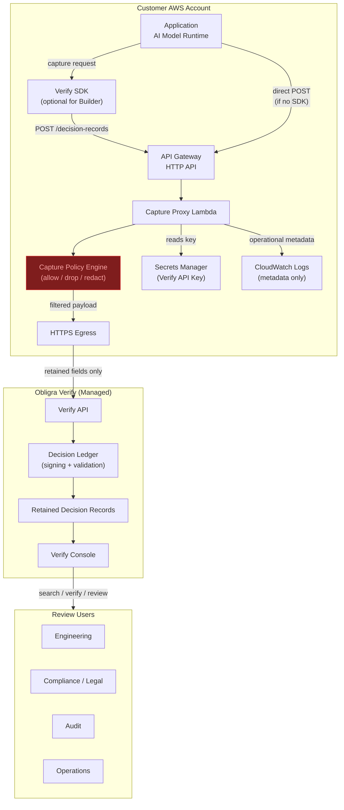

# Customer Integration Reference Architecture

## 1. Overview

This document describes how customers integrate their AI workflows with Obligra Verify to capture retained decision records. It covers deployment patterns from simple evaluation through enterprise governance, and explains the role of the customer-owned capture proxy and capture policy engine.

## 2. Core Principle

**The customer controls what becomes a retained decision record.**

Verify is not a surveillance logger. The customer-owned capture proxy makes the capture decision explicit. Data only reaches Verify after passing through a customer-controlled policy boundary that determines what is retained, what is dropped, and what is redacted — before anything leaves the customer's AWS account.

## 3. Deployment Patterns

### Builder (Evaluation / Integration Development)

Developer testing the SDK, building initial integration, evaluating Verify.

- **SDK direct** — no proxy, no infrastructure
- API key in environment variable
- Developer controls what they send via SDK field choices
- Suitable for sandbox/dev environments

```
Customer App → Verify SDK → Verify API
```

### Production (Single-team, controlled workloads)

Production AI workloads where the team controls what gets captured and the API key is managed securely.

- SDK sends to customer-owned proxy
- Capture policy recommended
- API key in Secrets Manager (not application code)
- Proxy optional if team trusts their SDK integration

```
Customer App → Customer Proxy (Lambda + Policy) → Verify API
                       ↑                ↑
              Capture Policy      Secrets Manager
```

### Governance (Multi-team, compliance-required)

Multiple teams use AI, compliance/legal requires audit trails, and a central platform team controls what data leaves the organization.

- Central platform team owns the proxy infrastructure
- Individual teams use the SDK but don't hold the Verify API key
- Capture policy enforced at the proxy — teams cannot bypass field restrictions
- API key centralized, not distributed to teams

```
Team A App → SDK →─┐
Team B App → SDK →─┤→ Customer API Gateway → Policy Lambda → Verify API
Team C App → SDK →─┘          ↑                    ↑
                        CORS / AuthZ         Capture Policy
                                             Secrets Manager
```

### Enterprise (Multi-account, regulated, custom domain)

Large organization with multiple AWS accounts, regulated industry requirements, and potentially multiple Verify environments.

- Centralized capture proxy in a shared services account
- Workload accounts don't have direct Verify API access
- Policy can vary per source account or workload identifier
- Custom domain, WAF, rate limiting
- Multiple capture policies per workload or environment

```
Workload Account A ──→┐
Workload Account B ──→┤→ Shared Services: API GW → WAF → Policy Lambda → Verify API
Workload Account C ──→┘          ↑              ↑           ↑
                          Custom Domain    Policy Store  Secrets Manager
```

## 4. Component Matrix

| Pattern | SDK | Proxy | Capture Policy | Secrets Manager | API Gateway | Lambda |
|---|---|---|---|---|---|---|
| Builder | ✅ | ❌ | ❌ | ❌ | ❌ | ❌ |
| Production | ✅ | Recommended | Recommended | ✅ | Optional | Optional |
| Governance | ✅ | ✅ Required | ✅ Required | ✅ | ✅ | ✅ |
| Enterprise | ✅ | ✅ Required | ✅ Required | ✅ | ✅ | ✅ |

## 5. Current Validated Architecture

Both paths are implemented and validated:

**Builder path:**
- Node.js SDK (`@obligra/verify-sdk`) validated with live capture
- GitHub install, zero dependencies
- Field validation (rejects `output`/`result`/`completion`)
- Returns `status: recorded` with `decisionRecordId`

**Proxy path:**
- CloudFormation template creates API Gateway + Lambda + IAM + CloudWatch
- Capture policy engine enforces allow/drop/redact before forwarding
- API key stored as encrypted Lambda env var (NoEcho)
- Validated: sensitive fields dropped, allowed fields retained, logs clean

## 6. Preferred Future Architecture

The capture policy proxy becomes the canonical production deployment:

- Every Production/Governance/Enterprise customer deploys a capture proxy
- The proxy is the data governance boundary between the customer and Verify
- The SDK provides developer convenience; the proxy provides security enforcement
- API keys never exist in application code for production deployments
- The policy is auditable by compliance without accessing application source

## 7. Capture Policy as First-Class Customer-Owned Boundary

The capture policy engine is a named architectural component, not an implementation detail.

**Why it matters:**

| Concern | How Policy Addresses It |
|---|---|
| Data governance | Customer explicitly declares what is retained vs dropped |
| Compliance auditability | Policy JSON is reviewable by compliance without reading code |
| Security boundary | Data physically cannot leave the account without passing through policy |
| Trust model | Customer enforces their own rules — no need to trust Verify to drop fields |
| Explicit intent | Verify receives only what the customer consciously chose to send |

**Policy modes:**

| Mode | Behavior |
|---|---|
| `forward_all` | Pass-through (default for backward compatibility) |
| `intent_only` | Only workflowId + model metadata, no prompt/response/context |
| `policy` | Explicit field allow/drop/redact per policy JSON |

## 8. CloudFormation Proxy as Canonical Deployment Model

| Customer Type | Canonical Deployment |
|---|---|
| Builder (evaluation) | Direct SDK — no proxy needed |
| Production | CloudFormation proxy with capture policy |
| Governance | CloudFormation proxy with capture policy (required) |
| Enterprise | Terraform or CDK proxy with capture policy (required) |

Available templates:
- `templates/verify-capture-proxy-preview.yaml` (CloudFormation)
- `terraform/verify-capture-proxy-preview/` (Terraform module)

## 9. Customer-Owned Components

These run in the customer's AWS account and are fully controlled by the customer:

| Component | Purpose |
|---|---|
| Verify SDK | Developer convenience for building capture payloads |
| API Gateway HTTP API | Public or internal endpoint for capture requests |
| Lambda Function | Applies capture policy, forwards to Verify |
| Capture Policy (JSON) | Declarative rules for what is retained/dropped/redacted |
| Secrets Manager | Stores Verify API key (never in code) |
| CloudWatch Log Group | Operational logs (no payloads logged) |
| IAM Role | Lambda execution with least-privilege (CloudWatch only) |

## 10. Obligra-Managed Components

These are hosted by Obligra and accessed over HTTPS:

| Component | Purpose |
|---|---|
| Verify API | Receives and stores retained decision records |
| Decision Ledger | Cryptographic signing and structural validation |
| Verify Console | Record retrieval, verification, review history, audit trail |
| Tenant/Workspace/Environment | Logical isolation per customer/team/stage |

## 11. Current Validation Status

| Validation | Status |
|---|---|
| SDK GitHub install | ✅ Validated |
| SDK field validation | ✅ Validated |
| SDK live capture | ✅ Validated |
| CloudFormation template syntax | ✅ Validated |
| CloudFormation deploy (pass-through) | ✅ Validated |
| CloudFormation deploy (capture policy) | ✅ Validated |
| Capture policy: field retention | ✅ Validated |
| Capture policy: field dropping | ✅ Validated |
| Capture policy: security.neverForward | ✅ Validated |
| CloudWatch log safety | ✅ Validated |
| Verify Console record visibility | ✅ Validated |
| Terraform template syntax | ✅ Validated (HCL) |
| Terraform live deploy | ⏳ Pending (TF-VAL-001) |
| External customer account (063088900096) | ⏳ Pending (CF-CUST-001) |

## 12. Preview URLs vs Future Production Domains

| Purpose | Current Preview | Production (after cutover) |
|---|---|---|
| Verify API base URL | `https://y1h3onv0f1.execute-api.us-east-1.amazonaws.com/dev` | `https://api.obligra.ai/api/v1` |
| Verify Console | `https://verify-console.emergent.host` | `https://console.obligra.ai` |
| SDK install | `npm install github:obligra/verify-node-sdk` | `npm install @obligra/verify-sdk` |

Templates use the preview URL as default. A parameter update is required at production domain cutover.

## 13. Architecture Diagram



### Diagram Notes

- The **Capture Policy Engine** (red) is the security boundary — data governance happens here
- **HTTPS Egress** represents the network boundary between customer and Obligra
- Only fields that pass the policy reach Verify — dropped/redacted fields never leave the customer account
- **Secrets Manager** holds the API key — it never exists in application code
- **CloudWatch Logs** contain only operational metadata (requestId, workflowId, statusCode, duration, field drop counts)
- **Review Users** access retained records through the Verify Console for verification, audit, and compliance workflows
